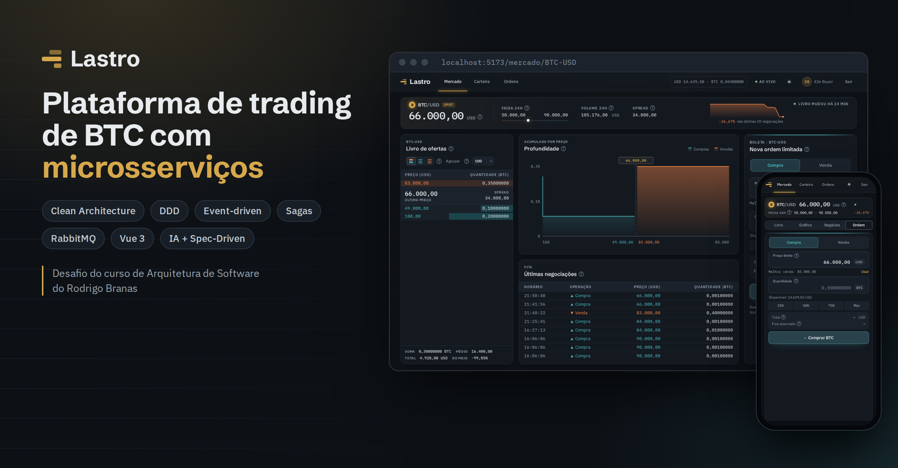
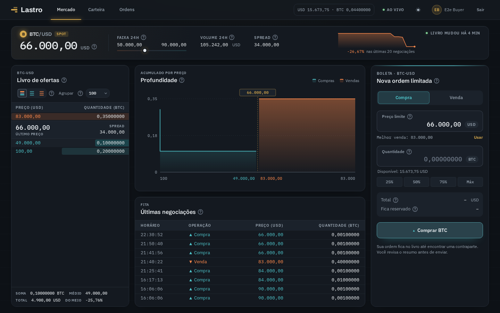
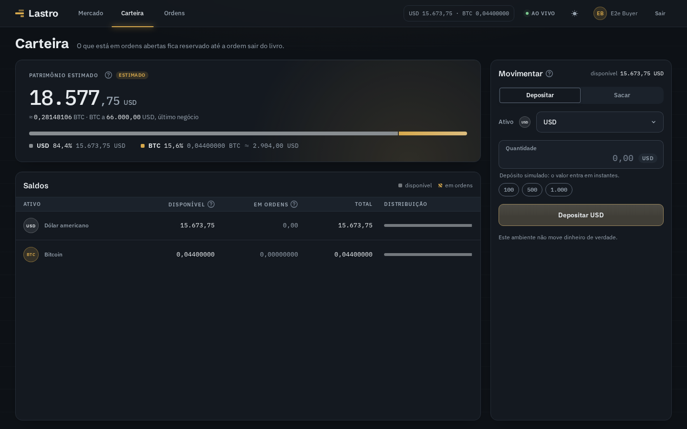
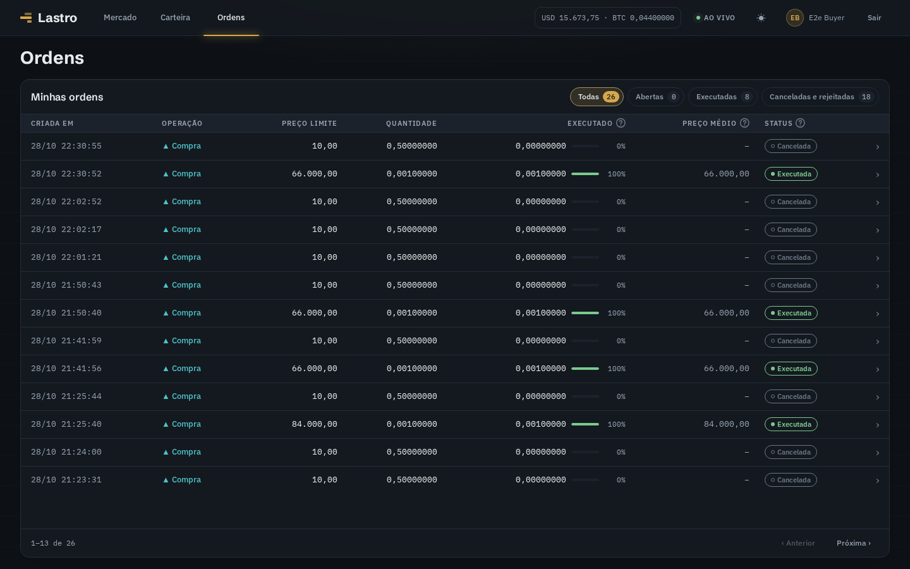
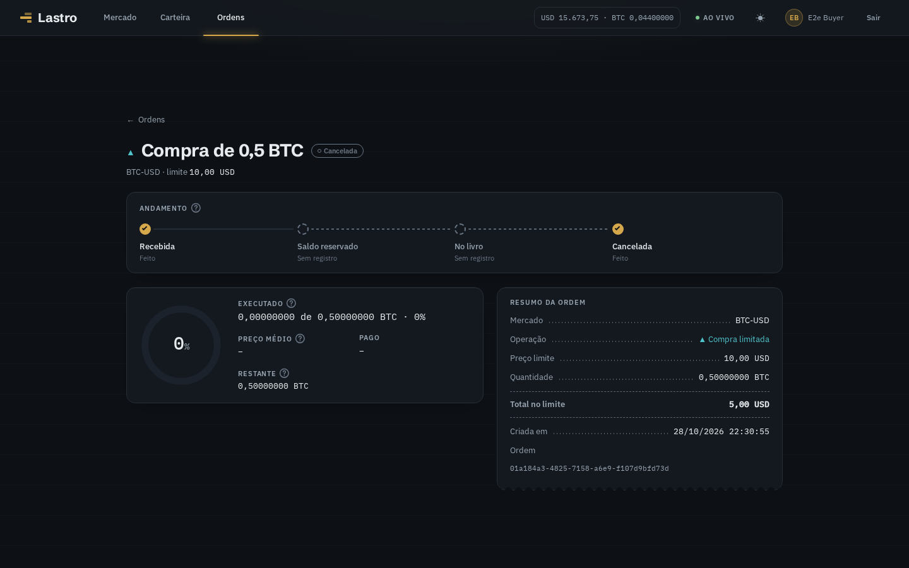
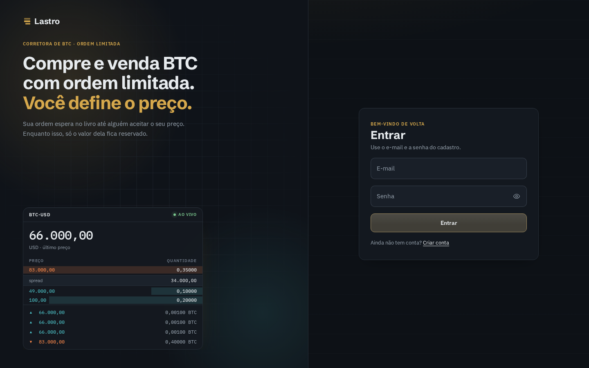
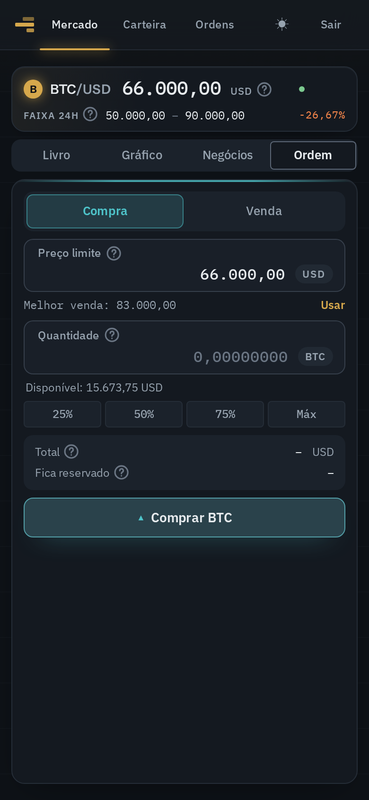

# software-architecture-practice



Plataforma de trading (compra e venda de ativos digitais, com BTC-USD como exemplo) construída como prática de arquitetura de software: microserviços, DDD, Clean Architecture, CQRS, sagas coreografadas, outbox/inbox e tudo em Docker.

Desafio proposto no curso de Arquitetura de Software do Rodrigo Branas (contas, depósitos e saques, ordens limitadas, livro de ofertas, matching e profundidade), expandido para uma arquitetura de microsserviços com especificação (`sdd/`), backend, front e testes.

Este é o repositório **guarda-chuva**: tem a especificação, a infraestrutura compartilhada e os comandos da plataforma, e **aponta** para um repositório por microserviço.

## O app

O cliente web (**Lastro**) roda em `http://localhost:5173`: mercado com livro de ofertas, profundidade e boleta; carteira com depósito e saque; ordens com filtros, detalhe e cancelamento. Todas as telas cabem na janela, do celular ao 4K, e cada termo tem uma ajuda (?) que explica o que é.


| Mercado | Carteira |
|---|---|
|  |  |
| **Ordens** | **Detalhe da ordem** |
|  |  |

| Entrar | Celular: mercado | Celular: boleta |
|---|---|---|
|  |  |  |

As imagens são regeradas com `make readme-media` no repositório do front.

## Microserviços

| Serviço | O que faz | Repositório |
|---|---|---|
| `account` | Cadastro e consulta da conta, com saldos projetados | [software-architecture-practice-account](https://github.com/erichenriquesm/software-architecture-practice-account) |
| `wallet` | Depósito, saque, reserva de saldo e liquidação | [software-architecture-practice-wallet](https://github.com/erichenriquesm/software-architecture-practice-wallet) |
| `order` | Ordens limitadas, cancelamento e histórico | [software-architecture-practice-order](https://github.com/erichenriquesm/software-architecture-practice-order) |
| `matching` | Livro de ofertas: casa compra e venda por preço-tempo | [software-architecture-practice-matching](https://github.com/erichenriquesm/software-architecture-practice-matching) |
| `market-data` | Profundidade, negociações e estatísticas de 24 h | [software-architecture-practice-market-data](https://github.com/erichenriquesm/software-architecture-practice-market-data) |
| `frontend` | Cliente web: Vue 3, Pinia, composables e o design system Lastro | [software-architecture-practice-frontend](https://github.com/erichenriquesm/software-architecture-practice-frontend) |

## Como subir tudo

Só precisa de Docker e `make`.

```bash
git clone https://github.com/erichenriquesm/software-architecture-practice.git
cd software-architecture-practice
make clone   # clona os cinco serviços em backend/<serviço>/ e o front em frontend/
make up      # cria os .env, sobe infra + serviços, roda as migrações e sobe o front
```

O app fica em `http://localhost:5173`; a API pública, em `http://127.0.0.1:8080` (edge). O painel do RabbitMQ fica em `http://127.0.0.1:15672` (`admin` / `admin-rabbitmq-dev`).

| Comando (na raiz) | O que faz |
|---|---|
| `make clone` · `make pull` | clona os serviços e o front que faltam · atualiza todos |
| `make up` · `make down` · `make ps` · `make logs` | sobe, derruba, lista e acompanha backend e front juntos |
| `make test` | todos os testes de todos os serviços, a checagem de contratos e os testes de unidade do front |
| `make e2e` | sobe tudo e roda o E2E do backend (pelo edge) e o do front (Playwright) |
| `make check` | confere se as cópias de contrato de cada serviço batem com o original do dono, e o layout da raiz |

## O que tem aqui

| Pasta | Conteúdo |
|---|---|
| [`sdd/`](sdd/README.md) | A especificação: princípios, design estratégico, mensageria, ambiente, testes, sagas, rate limiting, autenticação e a spec de cada serviço |
| `backend/infra/` | RabbitMQ, Redis e o edge (nginx), mais os contratos sem dono (envelope e catálogo de mercados) |
| `backend/scripts/` | `check-schemas.ts` |
| `Makefile`, `repos.txt` | Os comandos de tudo (chamam os `Makefile` de `backend/` e `frontend/`) e a lista dos repositórios |
| `backend/Makefile`, `backend/docker-compose.yml` | Comandos só do backend (migrações, infra, rebuild das projeções) e o compose da plataforma |
