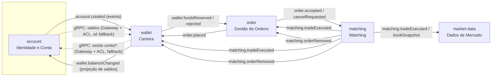

# 02 — Design Estratégico (DDD)

> Status: **spec** · Fonte: [objective.md](objective.md)

Este documento define **onde ficam as fronteiras** da plataforma de trading e **por quê**. As specs de cada serviço ([services/](services/)) detalham o interior de cada fronteira.

---

## 1. Subdomínios

| Subdomínio | Tipo | Por quê |
|---|---|---|
| **Matching (Livro de Ofertas)** | **Core** | É o que diferencia a plataforma: regra de preço-tempo, execução parcial, preço da ordem mais antiga. Erro aqui = negociação errada. Merece o modelo mais rico e os melhores testes. |
| **Gestão de Ordens** | Core (de suporte ao matching) | Ciclo de vida da ordem visto pelo usuário: criada, aberta, parcialmente executada, executada, cancelada, rejeitada. Histórico por conta. |
| **Carteira (Custódia de saldo)** | Supporting (crítico) | Não diferencia o negócio, mas lida com dinheiro: depósito, saque, **reserva de saldo** para ordens abertas e **liquidação** das negociações. Exige consistência forte por conta. |
| **Dados de Mercado** | Supporting | Profundidade (depth), histórico de negociações e estatísticas (spread, min, max, volume). É leitura derivada de fatos que acontecem em outro lugar. |
| **Identidade e Conta** | Generic | Cadastro com nome, e-mail, CPF e senha. Problema resolvido no mercado; modelo simples. |

---

## 2. Bounded Contexts → Microserviços

Cada bounded context vira **um microserviço**, com **um banco Postgres próprio** e **sua própria linguagem ubíqua**.

| Bounded Context | Serviço | Workload dominante | Modelagem |
|---|---|---|---|
| Identidade e Conta | `account` | Baixo volume, HTTP síncrono, leitura simples | Modelo leve (entidade + VOs) |
| Carteira | `wallet` | Escrita concorrente na **mesma conta**, transacional, consistência forte | **Modelo rico** (agregado `Wallet`) |
| Gestão de Ordens | `order` | HTTP de escrita (criar/cancelar) + máquina de estados alimentada por eventos | **Modelo rico** (agregado `Order`) |
| Matching | `matching` | CPU/latência, **escritor único e sequencial por mercado**, sem HTTP público | **Modelo mais rico** (agregado `OrderBook`) |
| Dados de Mercado | `market-data` | **Leitura intensa**, projeções pré-agregadas (CQRS) | Sem camada de domínio: projeções + DAOs |

### Por que separar assim (e não de outro jeito)

**Ordens ≠ Matching.** Parecem o mesmo assunto, mas têm workloads opostos:
- `order` atende o usuário: HTTP, validação, consulta por conta, estados. Pode escalar horizontalmente.
- `matching` precisa processar as ordens de um mercado **uma de cada vez, em ordem de chegada** (prioridade preço-tempo). Não escala horizontalmente dentro de um mercado; escala **por mercado**. Misturar os dois faria o lado HTTP herdar a restrição de escritor único.
- Linguagem diferente: em `order`, "ordem" tem status e histórico; em `matching`, o que existe é uma **entrada no livro** com quantidade restante e posição na fila.

**Carteira ≠ Conta.** A conta muda raramente (cadastro); o saldo muda a cada ordem e negociação. A regra "verificar saldo considerando ordens em aberto" é uma **reserva de saldo**, e reserva é conceito de carteira, não de cadastro. Separar evita que o cadastro herde a contenção de escrita do saldo.

**Dados de Mercado separado do Matching.** O motor de matching não deve gastar ciclo respondendo consultas de depth/estatística. Leitura vira projeção alimentada por eventos, com escala e modelo próprios.

**Por que não mais serviços.** Não criamos serviço de "Mercados" (catálogo de pares) nem de "Notificação": hoje só existe `BTC-USD`, num catálogo estático com filtros (`markets.json`, com original em `backend/infra/schemas/` e cópia em `src/infra/schemas/` de cada serviço que usa) (ver [Q5](99-decisoes.md#q5)). Serviço sem comportamento próprio é custo sem retorno.

---

## 3. Linguagem ubíqua por contexto

O mesmo termo do glossário muda de sentido conforme o contexto. No código, usamos os termos em inglês do glossário.

| Termo | `account` | `wallet` | `order` | `matching` | `market-data` |
|---|---|---|---|---|---|
| **Account** | Agregado: pessoa cadastrada | Só um `accountId` (dono da carteira) | Só um `accountId` | Só um `accountId` (repassado no trade) | — |
| **Asset** | — | Item com saldo (`BTC`, `USD`) | Lados do `marketId` | Lados do `marketId` | Lados do `marketId` |
| **Order** | — | Motivo de uma **reserva** (`orderId`) | **Agregado** com status e fills | **Entrada no livro** (preço, restante, sequência) | — |
| **Balance** | — | `available` + `reserved` por ativo | — | — | — |
| **Trade** | — | Fato a **liquidar** | Fato que gera **fill** | Resultado do **match** (cria) | Linha de **histórico** |
| **Market** | — | — | Par validado (`BTC-USD`) | Um livro de ofertas | Estatísticas do par |
| **Depth** | — | — | — | Snapshot dos níveis de preço | **Visão agregada** com precisão |

Termos que **só existem** em um contexto:
- `wallet`: **Reservation** (saldo comprometido com uma ordem), **Settlement** (liquidação), **Ledger entry** (lançamento).
- `order`: **Fill** (execução parcial ou total aplicada à ordem), **Fill price** (preço médio ponderado).
- `matching`: **Maker** (ordem mais antiga, já no livro, define o preço), **Taker** (ordem que entrou e provocou o match, define o `side` do trade), **Book sequence**.

---

## 4. Context Map

Linha cheia = assíncrono (RabbitMQ). Linha tracejada = síncrono interno (gRPC). A API pública é REST, via edge proxy (§6).

### Relações

| Upstream → Downstream | Padrão | Observação |
|---|---|---|
| Todos → consumidores de eventos | **Published Language** | Eventos versionados com JSON Schema: o produtor é dono do schema; cada consumidor guarda cópia, verificada por `scripts/check-schemas` ([princípios §6](01-principios.md#6-c%C3%B3digo-compartilhado-n%C3%A3o-h%C3%A1)). Produtor não conhece consumidor. |
| `account` → `wallet` (gRPC) | **Customer/Supplier + ACL** | `wallet` traduz a resposta de `account` para o seu conceito (`AccountExists`). Usado só como fallback. |
| `wallet` → `account` | **Published Language (projeção) + ACL de fallback** | `account` mantém uma projeção local dos saldos a partir de `wallet.balanceChanged`. O gRPC com ACL só é usado quando a projeção ainda não existe. |
| `order` ↔ `wallet` | **Partnership (saga coreografada)** | Os dois evoluem juntos o fluxo de reserva. Mudança no contrato exige acordo dos dois. |
| `matching` → `order`, `wallet`, `market-data` | **Open Host (eventos)** | `matching` é a fonte da verdade de negociações. Os demais se conformam. |
| `market-data` | **Conformist** | Projeta os eventos como vêm; não tem modelo próprio a defender. |

### Regras de fronteira

1. **Nenhum serviço lê o banco de outro.** Integração só por evento ou gRPC via Gateway + ACL.
2. **Agregados de contextos diferentes se referenciam por id** (`accountId`, `orderId`), nunca por objeto.
3. **Nenhum código é compartilhado entre serviços** — nem domínio, nem técnico. Cada serviço tem os próprios RNF em `src/infra/platform/`, escritos à mão (sem gerador nem template), e cópia dos contratos que usa em `src/infra/schemas/`. Ver [princípios §6](01-principios.md#6-c%C3%B3digo-compartilhado-n%C3%A3o-h%C3%A1).
4. **Chamada síncrona entre serviços (gRPC) é exceção.** Leitura de dado de outro contexto vem de **projeção local** alimentada por evento (CQRS). gRPC só como fallback, quando a projeção ainda não existe, e sempre com Gateway + ACL, timeout, retry com backoff e fallback.
5. **Leitura pública nunca espera outro serviço.** Toda consulta é respondida por uma tabela de projeção local (`*_view`) já no formato da resposta. Ver [princípios: CQRS e tabelas de projeção](01-principios.md#cqrs-e-tabelas-de-proje%C3%A7%C3%A3o).

---

## 5. Fluxos entre contextos (visão estratégica)

Detalhe dos eventos, filas e retries em [03-mensageria.md](03-mensageria.md). Passos, pivot, compensações e timeout de cada saga em [06-sagas.md](06-sagas.md).

### 5.1 Signup → carteira criada
`account` cria a conta → publica `account.created` → `wallet` abre a carteira vazia.

### 5.2 PlaceOrder (saga coreografada)
1. `order` valida e cria a ordem em `pending` → `order.placed`.
2. `wallet` tenta **reservar** o saldo:
   - compra em `BTC-USD`: reserva `quantity × price` de `USD`;
   - venda: reserva `quantity` de `BTC`.
   → `wallet.fundsReserved` ou `wallet.fundsReservationRejected`.
3. `order` → `open` e publica `order.accepted` (ou `rejected`, fim). Se a reserva não chegar dentro do timeout, ou se o usuário cancelar antes, `order` marca `expired`/`cancelled` e publica `order.voided`, e o `wallet` compensa liberando a reserva.
4. `matching` insere no livro, tenta casar e publica `matching.tradeExecuted` (0..N) e `matching.bookSnapshot`.
5. `order` aplica os fills; `wallet` liquida; `market-data` projeta.

A reserva é o que garante a regra **"considerar ordens em aberto, evitando comprar ou vender duas vezes"**: o saldo reservado sai do `available` e não pode ser usado de novo.

### 5.3 CancelOrder
`order` → `cancelRequested` → `order.cancelRequested` → `matching` remove do livro (se ainda estiver) → `matching.orderRemoved` (com quantidade restante) → `order` marca `cancelled` e `wallet` libera a reserva restante.
Se a ordem já tinha sido totalmente executada, `matching` publica `matching.orderCancelRejected` e `order` volta ao status anterior.

### 5.4 GetAccount (projeção local, sem chamada síncrona)
`wallet` publica `wallet.balanceChanged` a cada mudança de saldo. `account` mantém a projeção `account_balance_view` e responde `GetAccount` com **uma consulta local**: dados cadastrais + `assets[]`.
Se a projeção ainda não tem saldos da conta (conta recém-criada), a corrente de fallback tenta o `wallet` via gRPC (Gateway + ACL) e, se ele estiver fora, responde **degradado** (dados cadastrais + aviso) em vez de falhar.

---

## 6. Mapa de endpoints públicos (REST) → contexto

| Endpoint | Serviço |
|---|---|
| `POST /signup` | `account` |
| `GET /accounts/:accountId` | `account` (saldos via projeção de `wallet`) |
| `POST /deposit` · `POST /withdraw` | `wallet` |
| `POST /place_order` · `POST /cancel_order` | `order` |
| `GET /accounts/:accountId/orders` · `GET /orders/:orderId` | `order` |
| `GET /markets/:marketId` · `/trades` · `/depth` | `market-data` |

O roteamento externo é feito por um **edge proxy** (reverse proxy, sem lógica). É o único ponto que o front conhece; na AWS, o papel dele se divide entre os serviços de borda descritos no [ambiente §6](04-ambiente-docker.md#6-refer%C3%AAncia-de-implanta%C3%A7%C3%A3o-na-aws-fora-do-escopo)). Não confundir com o **Gateway + ACL**, que é o padrão de integração síncrona (gRPC) entre serviços (ver [princípios](01-principios.md#4-integra%C3%A7%C3%A3o-s%C3%ADncrona-gateway--acl)).
