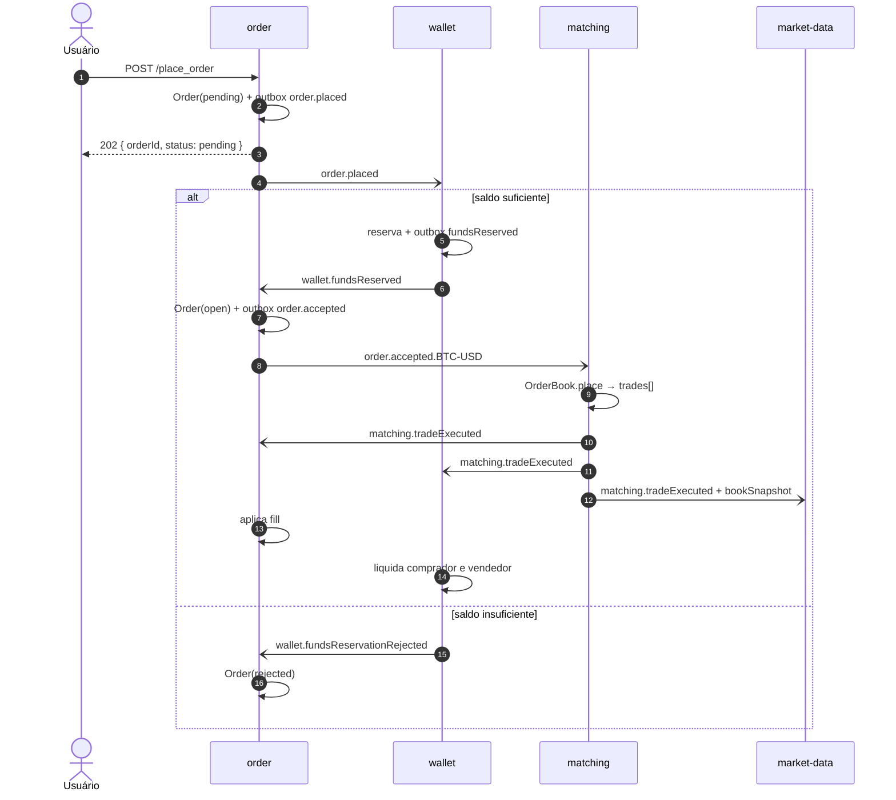
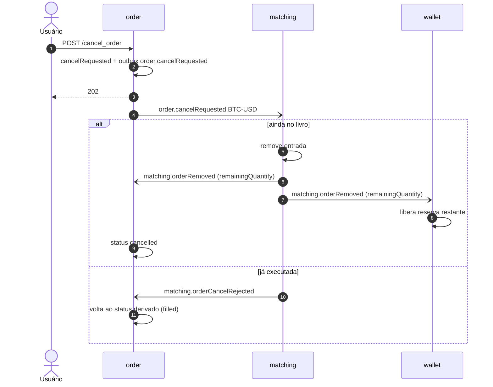

# 03 — Mensageria (RabbitMQ)

> Status: **spec** · Um único RabbitMQ para toda a plataforma.

---

> **Adapters:** nenhum caso de uso fala com o RabbitMQ. Publicar é a porta `EventPublisher`, implementada pelo adapter de saída `OutboxEventPublisher`, que grava no outbox; o relay do outbox é quem publica no broker. Consumir é responsabilidade de um adapter de entrada por fila, que valida o envelope, checa a inbox, traduz o payload e chama o caso de uso. Ver [princípios: Ports & Adapters](01-principios.md#ports--adapters-dentro-da-infra).

## 1. Topologia: quem declara o quê

O mesmo broker é visto de duas perspectivas, e **cada uma declara só a sua parte**:

| Perspectiva | Declara | **Não** declara |
|---|---|---|
| **Produtor** | A **exchange** do seu contexto (`topic`, durável) | Filas e bindings. O produtor não sabe quem consome. |
| **Consumidor** | A **sua fila**, o **binding** dela nas exchanges que interessam, e as filas de retry/DLQ | Exchange de outro contexto (só referencia; assume que existe) |

Isso mantém o produtor desacoplado: um novo consumidor entra criando a própria fila e o binding, sem mudar o produtor. As exchanges são criadas na subida do broker, pelo `definitions.template.json` de `backend/infra/rabbitmq/` ([autenticação §3](08-autenticacao-entre-servicos.md#3-rabbitmq-usu%C3%A1rio-e-permiss%C3%B5es-por-servi%C3%A7o)). Assim nenhum serviço depende da ordem de subida dos outros, e o consumidor só **verifica** (`checkExchange`) a exchange que referencia: ele não tem permissão para declarar exchange de outro contexto.

Cada serviço conecta com **usuário próprio**, e as permissões do broker reforçam esta tabela: o produtor só publica na própria exchange; o consumidor só declara e lê as próprias filas.

### Exchanges (uma por contexto produtor)

| Exchange | Tipo | Dono |
|---|---|---|
| `account.events` | topic | `account` |
| `wallet.events` | topic | `wallet` |
| `order.events` | topic | `order` |
| `matching.events` | topic | `matching` |
| `retry` | direct | Infra comum de retry: criada pelo `definitions.template.json` da infra; usada pelo kit de mensageria de cada serviço (`src/infra/platform/messaging/`) |

`market-data` não publica eventos.

### Routing key
`<contexto>.<evento>[.<marketId>]` — o sufixo de mercado existe nos eventos que o `matching` precisa particionar por mercado e nos que ele publica.
Ex.: `order.accepted.BTC-USD`, `matching.tradeExecuted.BTC-USD`, `account.created`.

### Filas (donas: o consumidor)

Nome: `<consumidor>.<assunto>`.

| Fila | Exchange → binding | Consumidor | Observação |
|---|---|---|---|
| `wallet.accountCreated` | `account.events` → `account.created` | `wallet` | Abre carteira |
| `wallet.orderPlaced` | `order.events` → `order.placed` | `wallet` | Reserva saldo |
| `wallet.tradeExecuted` | `matching.events` → `matching.tradeExecuted.*` | `wallet` | Liquida |
| `wallet.orderRemoved` | `matching.events` → `matching.orderRemoved.*` | `wallet` | Libera reserva restante |
| `wallet.orderVoided` | `order.events` → `order.voided` | `wallet` | Compensação da saga S2 |
| `marketData.matchingLog` | `matching.events` → `matching.#` | `market-data` | **Stream** (não é fila comum): log relido do início para reconstruir projeções (§8) |
| `order.fundsReservation` | `wallet.events` → `wallet.fundsReserved`, `wallet.fundsReservationRejected` | `order` | Abre ou rejeita a ordem |
| `order.matchingResults` | `matching.events` → `matching.tradeExecuted.*`, `matching.orderRemoved.*`, `matching.orderCancelRejected.*` | `order` | Fills e cancelamento |
| `matching.orders.BTC-USD` | `order.events` → `order.accepted.BTC-USD`, `order.cancelRequested.BTC-USD` | `matching` | **Ordenada**: ver §6 |
| `marketData.trades` | `matching.events` → `matching.tradeExecuted.*` | `market-data` | Histórico/estatística |
| `marketData.book` | `matching.events` → `matching.bookSnapshot.*` | `market-data` | Depth e top of book |
| `account.walletBalances` | `wallet.events` → `wallet.balanceChanged` | `account` | Projeção de saldos para o `GetAccount` |

Configuração padrão de fila: `durable`, `x-queue-type: quorum`, mensagens `persistent`, `prefetch` 10 (exceto `matching`: 1).

---

## 2. Envelope

Toda mensagem tem o mesmo envelope (schema `envelope.schema.json`: original em `backend/infra/contracts/`, cópia em `src/infra/contracts/` de cada serviço):

```json
{
  "eventId": "uuid",
  "type": "order.placed",
  "version": 1,
  "occurredAt": "2026-10-27T12:00:00.000Z",
  "producer": "order",
  "correlationId": "uuid (id do fluxo, nasce no request HTTP)",
  "causationId": "uuid (eventId que causou este, ou null)",
  "payload": { }
}
```

- `eventId` é a base da chave de **idempotência** no consumidor (`inbox.message_key`, §5).
- `correlationId` atravessa todo o fluxo (signup → … → trade) e vai em todo log.
- Valores decimais trafegam como **string** (`"0.50000000"`), nunca como `number`.
- **Evolução:** mudança compatível (campo novo opcional) mantém `version`. Mudança incompatível = novo `version`; o produtor publica as duas versões até todos os consumidores migrarem.

---

## 3. Catálogo de eventos (v1)

Só publicamos evento que tem consumidor ou que é fato central do negócio. Ex.: não existe `order.rejected`, porque ninguém consome.

| Evento | Produtor | Payload | Consumidores |
|---|---|---|---|
| `account.created` | account | `accountId` | wallet |
| `order.placed` | order | `orderId, accountId, marketId, side, quantity, price` | wallet |
| `wallet.fundsReserved` | wallet | `orderId, accountId, assetId, amount` | order |
| `wallet.fundsReservationRejected` | wallet | `orderId, accountId, reason` (`INSUFFICIENT_FUNDS` \| `WALLET_NOT_FOUND`) | order |
| `order.accepted` | order | `orderId, accountId, marketId, side, quantity, price, acceptedAt` | matching |
| `order.cancelRequested` | order | `orderId, marketId` | matching |
| `order.voided` | order | `orderId, accountId, marketId, side, quantity, price, reason` (`EXPIRED` \| `CANCELLED`) | wallet (compensação) |
| `matching.tradeExecuted` | matching | `tradeId, marketId, buyOrderId, sellOrderId, buyAccountId, sellAccountId, side (lado do taker), quantity, price (do maker), executedAt, bookSequence` | order, wallet, market-data |
| `matching.orderRemoved` | matching | `orderId, accountId, marketId, side, remainingQuantity, reason` (`CANCELLED` \| `SELF_TRADE_PREVENTION`) | order, wallet |
| `matching.orderCancelRejected` | matching | `orderId, marketId, reason` (`NOT_IN_BOOK`) | order |
| `matching.bookSnapshot` | matching | `marketId, sequence, bids[{price, quantity}], asks[{price, quantity}]` | market-data |
| `wallet.balanceChanged` | wallet | `accountId, assetId, available, reserved, version` (estado final do saldo, não o delta) | account |

### Eventos de estado para projeções
`wallet.balanceChanged` e `matching.bookSnapshot` carregam o **estado final** com uma `version`/`sequence`, e não a diferença. Assim a projeção do consumidor é *last-write-wins*: ignora versão mais antiga, aceita duplicata e desordem sem corromper. Ver [princípios: CQRS e tabelas de projeção](01-principios.md#cqrs-e-tabelas-de-proje%C3%A7%C3%A3o).

### Por que `bookSnapshot` e não deltas
Com deltas (`orderRested`, `levelChanged`), o `market-data` teria que reconstruir o livro aplicando cada mudança na ordem exata, e um evento perdido ou fora de ordem corromperia a profundidade. O snapshot tem `sequence`: o consumidor guarda só o mais recente e ignora os antigos. É **idempotente e tolerante a desordem**. O custo é payload maior, aceitável aqui. Se o livro crescer muito, trocar por deltas + snapshot periódico.

---

## 4. Retry, backoff e DLQ

### Classificação do erro no consumidor

| Tipo | Exemplo | Ação |
|---|---|---|
| **Rejeição de negócio** | Saldo insuficiente | Não é erro: o handler publica o evento de rejeição e dá `ack`. |
| **Transitório** | Postgres fora, timeout, deadlock | **Retry com backoff** |
| **Permanente** | Payload fora do schema, versão desconhecida, bug | **DLQ direto**, sem retry |

### Retry por filas com atraso (backoff exponencial)

Para cada fila `<q>` (exceto a do `matching`, ver §6), o kit de mensageria do serviço (`src/infra/platform/messaging/`) declara:

```
<q>            ligada à exchange retry com a chave <q>
<q>.retry.1s   x-message-ttl=1000    ┐
<q>.retry.5s   x-message-ttl=5000    ├─ x-dead-letter-exchange=retry + x-dead-letter-routing-key=<q>  → volta para <q>
<q>.retry.25s  x-message-ttl=25000   ┘
<q>.dlq        ligada a retry com a chave <q>.dlq (parking lot, sem consumidor automático)
```

Fluxo da falha transitória:
1. O consumidor lê `x-attempt` (padrão 0), publica uma cópia na exchange `retry` com routing key `<q>.retry.<tier>` e `x-attempt + 1`, e dá `ack` na original.
2. A mensagem espera o TTL na fila de atraso e volta, via dead-letter pela própria exchange `retry` (chave `<q>`), para `<q>`. Não se usa a exchange padrão (`""`) como dead-letter, porque ela exigiria permissão em `amq.default` ([autenticação §3](08-autenticacao-entre-servicos.md#3-rabbitmq-usu%C3%A1rio-e-permiss%C3%B5es-por-servi%C3%A7o)).
3. Depois da 3ª tentativa, vai para `<q>.dlq` (publicada em `retry` com a chave `<q>.dlq`) com headers `x-error`, `x-failed-at`.

Backoff: **1s → 5s → 25s** (base 5). TTL por fila não permite jitter por mensagem. Aceitável porque as mensagens já chegam espalhadas no tempo. Usamos uma fila por nível (e não TTL por mensagem numa fila só) porque, no RabbitMQ, mensagem com TTL só expira quando chega à cabeça da fila, o que travaria as outras.

### DLQ
- Alarme quando `<q>.dlq` tiver mensagens (métrica do management plugin).
- Reprocessamento manual: script `npm run dlq:replay -- <q>` (container), que republica na fila original zerando `x-attempt`.

### Conexão com o broker
Reconexão com backoff exponencial + jitter (`base=500ms`, `cap=30s`, sem limite de tentativas). Enquanto desconectado, o outbox acumula; nada se perde.

---

## 5. Outbox e Inbox

Garantem **entrega pelo menos uma vez** sem perder nem duplicar efeito.

### Outbox (produtor)
Mudança de estado e evento são gravados **na mesma transação**:

```sql
create table outbox (
  id            bigserial primary key,      -- publication order
  event_id      uuid not null unique,
  type          text not null,
  routing_key   text not null,
  envelope      jsonb not null,
  created_at    timestamptz not null default now(),
  published_at  timestamptz
);
create index outbox_unpublished on outbox (id) where published_at is null;
```

**Relay** (processo `worker` de cada serviço): a cada 200 ms lê até 100 linhas não publicadas `order by id` com `for update skip locked`, publica com **publisher confirms** e marca `published_at`. Um único relay ativo por serviço (`pg_advisory_lock`) para preservar a ordem de publicação.

### Inbox (consumidor)

```sql
create table inbox (
  consumer      text not null,     -- queue name
  message_key   text not null,
  processed_at  timestamptz not null default now(),
  primary key (consumer, message_key)
);
```

O handler insere em `inbox` **na mesma transação** do efeito. Se já existir: é duplicata, dá `ack` sem fazer nada.

**`message_key`** é o `eventId` quando uma mensagem gera uma única transação. Quando o adapter de entrada transforma uma mensagem em **várias** transações (ex.: um trade gera um `ApplyFill` por ordem), cada transação tem sua chave: `eventId:<sujeito>`, como `eventId:orderId` no `order` e `eventId:accountId:role` no `wallet`. Assim, se a segunda transação falhar e a mensagem voltar, a primeira não é aplicada de novo.

### Handlers comutativos
Retry por fila de atraso **não preserva a ordem** entre mensagens. Por isso, onde dois eventos podem chegar em qualquer ordem, o efeito precisa ser o mesmo:
- `wallet`: `tradeExecuted` consome da reserva exatamente o que o trade usou; `orderRemoved` libera exatamente `remainingQuantity`. A soma bate em qualquer ordem.
- `order`: fill é sempre aplicado; o status é **derivado** de `fillQuantity` e `removedQuantity` (ver [order](services/order.md)).

---

## 6. Ordem garantida: a fila do matching

O `matching` precisa processar as ordens de um mercado **na ordem em que foram aceitas** (prioridade preço-tempo). Por isso a fila `matching.orders.<marketId>` é diferente:

- **Uma fila por mercado**, com os bindings `order.accepted.<marketId>` e `order.cancelRequested.<marketId>` **na mesma fila**, para que aceite e cancelamento da mesma ordem nunca se invertam.
- `x-single-active-consumer: true` — várias réplicas podem subir, só uma consome; as outras ficam de reserva.
- `prefetch: 1`.
- **Sem fila de retry.** Falha transitória → retry **em processo** com backoff exponencial + jitter (`base=200ms`, `cap=10s`, sem limite), **bloqueando o mercado** até voltar. É o comportamento correto: pular uma ordem quebraria a prioridade.
- Falha permanente → DLQ + alarme, e segue para a próxima.

A ordem de publicação de `order.accepted` e `order.cancelRequested` é garantida pelo relay ordenado do outbox de `order` (§5).

---

## 7. Sequências

A especificação completa das sagas (passos, pivot, compensações, timeout) está em [06-sagas.md](06-sagas.md). Abaixo, só os caminhos principais.

### PlaceOrder até o trade



### CancelOrder



---

## 8. Stream para replay de projeções

Fila comum apaga a mensagem depois do `ack`, então não serve para reconstruir projeção. Para isso, o `market-data` declara um **RabbitMQ Stream** no mesmo broker ([Q17](99-decisoes.md#q17)):

| Item | Valor |
|---|---|
| Nome | `marketData.matchingLog` (`x-queue-type: stream`) |
| Binding | `matching.events` → `matching.#` |
| Retenção | `x-max-age: 30D` |
| Uso normal | Nenhum: as projeções são alimentadas pelas filas `marketData.trades` e `marketData.book` |
| Uso no rebuild | `make projections-rebuild` no `market-data` (`npm run projections:rebuild` no `market-data-worker`) apaga as `*_view` e consome o stream com `x-stream-offset: first` até alcançar o fim, que o consumidor reconhece por ficar ocioso (`REBUILD_IDLE_TIMEOUT`): pela AMQP 0.9.1 ele não sabe qual é o último offset |

Reler é seguro porque as projeções são idempotentes (`trade_id`) e *last-write-wins* (`sequence`). Continua valendo a regra do §1: quem precisa do replay (o consumidor) declara o stream; o `matching` não sabe que ele existe.
