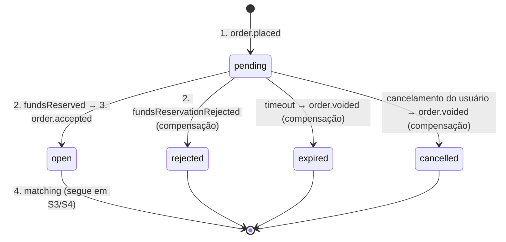

# 06 — Sagas coreografadas

> Status: **spec** · Vale para toda operação que altera estado em **mais de um serviço**.

Cada serviço tem seu banco, então não existe transação distribuída (2PC). Uma operação que atravessa serviços vira uma **saga**: uma sequência de **transações locais**, uma por serviço, encadeadas por eventos. Se um passo não pode seguir, os passos anteriores são desfeitos por **transações de compensação**.

---

## 1. Por que coreografia (e não orquestração)

| | Coreografia (escolhida) | Orquestração |
|---|---|---|
| Quem coordena | Cada participante reage a eventos e publica o próximo | Um orquestrador manda comandos e guarda o estado da saga |
| Acoplamento | Participantes conhecem só eventos | Orquestrador conhece todos os participantes |
| Bom para | Poucos passos (≤ 4), fluxo linear | Muitos passos, ramificações, regras de fluxo complexas |

As sagas desta plataforma têm de 2 a 4 passos e são lineares. Um orquestrador seria um serviço a mais sem regra própria. **Se uma saga passar de 4 participantes ou ganhar ramificações, reavaliar para orquestração.**

---

## 2. Vocabulário

Classificação de cada transação local da saga:

| Tipo | Significado |
|---|---|
| **Compensável** | Pode ser desfeita por uma transação de compensação. Vem **antes** do pivot. |
| **Pivot** | Ponto sem volta. Se for confirmada, a saga **vai até o fim**. Se falhar, a saga compensa. |
| **Repetível** | Vem **depois** do pivot. Não pode falhar por regra de negócio; só por falha técnica, e aí é repetida até dar certo (retry → DLQ → intervenção manual). |

Regra: **compensação também é repetível.** Ela nunca pode falhar por regra de negócio.

---

## 3. Regras gerais

1. **Cada passo é uma transação local** que muda o estado **e** grava o próximo evento no **outbox**, juntos ([mensageria §5](03-mensageria.md#5-outbox-e-inbox)).
2. **Todo passo é idempotente** (inbox por `eventId`). A saga pode receber o mesmo evento várias vezes.
3. **`correlationId` = id da saga.** Nasce no request HTTP, atravessa todos os eventos e aparece em todos os logs. A saga inteira se acha procurando por ele.
4. **Dono da saga:** o serviço que a inicia guarda o **estado da saga** no próprio agregado (o status da ordem é o estado da saga). Não há tabela de saga separada.
5. **Rejeição de negócio é um evento**, não exceção. É ela que dispara a compensação.
6. **Timeout é responsabilidade do dono da saga.** Saga parada além do limite é encerrada pelo dono, com compensação.
7. **Toda saga tem a tabela de falhas preenchida** (§5): o que acontece se cada passo falhar.

### Contramedidas para a falta de isolamento

Entre um passo e outro, outros fluxos enxergam estados intermediários. As contramedidas usadas:

| Contramedida | O que é | Onde |
|---|---|---|
| **Semantic lock** | Status intermediário que diz "em andamento, não mexa" | Ordem em `pending` (não pode ser cancelada) e `cancelling` (não aceita outro cancelamento) |
| **Atualização comutativa** | Efeitos que dão o mesmo resultado em qualquer ordem | Liquidação × liberação de reserva no `wallet`; fill × remoção no `order` |
| **Versão / sequência** | Ignorar evento mais antigo que o estado atual | Projeções (`balanceChanged`, `bookSnapshot`) |
| **Lápide (tombstone)** | Registrar "este id foi encerrado" para que um evento atrasado não ressuscite a operação | Tabela `voided_order` no `wallet` para ordem expirada ou cancelada antes de entrar no livro |

---

## 4. Catálogo de sagas

| Saga | Dono | Participantes | Compensa? |
|---|---|---|---|
| [S1 — Abertura de carteira](#s1--abertura-de-carteira) | `account` | account → wallet | Não (só passos repetíveis) |
| [S2 — Colocação de ordem](#s2--colocação-de-ordem-placeorder) | `order` | order → wallet → order → matching | **Sim** |
| [S3 — Liquidação de negociação](#s3--liquidação-de-negociação) | `matching` | matching → wallet, order | Não (começa no pivot) |
| [S4 — Cancelamento de ordem](#s4--cancelamento-de-ordem-cancelorder) | `order` | order → matching → order, wallet | **Sim** |

---

## 5. Sagas

### S1 — Abertura de carteira

| # | Serviço | Transação local | Tipo | Evento emitido |
|---|---|---|---|---|
| 1 | account | Cria a conta | **Pivot** | `account.created` |
| 2 | wallet | Abre a carteira vazia | Repetível | — |

Falha no passo 2: retry → DLQ. Enquanto isso, a corrente de fallback do `wallet` (gRPC `AccountService.Exists`) abre a carteira sob demanda, então o usuário não fica bloqueado ([wallet §7](services/wallet.md#7-integração-síncrona-e-resiliência)).

---

### S2 — Colocação de ordem (PlaceOrder)

| # | Serviço | Transação local | Tipo | Evento emitido | Compensação |
|---|---|---|---|---|---|
| 1 | order | Cria a ordem em `pending` | Compensável | `order.placed` | Ordem → `rejected`, `expired` ou `cancelled` |
| 2 | wallet | Reserva o saldo | Compensável | `wallet.fundsReserved` · ou `wallet.fundsReservationRejected` | Libera ou anula a reserva (ao receber `order.voided`) |
| 3 | order | **Decide**: ordem → `open` | **Pivot** | `order.accepted.<m>` | — |
| 4 | matching | Insere no livro e tenta casar (com prevenção de self-trade) | Repetível | `matching.tradeExecuted` (0..N), `matching.orderRemoved` (STP), `matching.bookSnapshot` | — |

O pivot é a **decisão do dono** no passo 3. O agregado `Order` sai de `pending` uma única vez: para `open` (segue) **ou** para `rejected`/`expired`/`cancelled` (compensa). Como é uma transição de um único agregado, com controle otimista, duas saídas nunca acontecem juntas: quem gravar primeiro decide. Depois de `open`, a ordem tem saldo garantido e **vai para o livro**.

Há **três caminhos de compensação**, e dois deles usam o mesmo evento:

| Gatilho | Status final | Evento | O que o `wallet` faz |
|---|---|---|---|
| `wallet` rejeitou a reserva | `rejected` | — (a rejeição já veio do `wallet`) | Nada: não reservou |
| Timeout do dono | `expired` | `order.voided` (`EXPIRED`) | Libera a reserva, ou grava a lápide |
| Usuário cancelou em `pending` ([Q7](99-decisoes.md#q7)) | `cancelled` | `order.voided` (`CANCELLED`) | Libera a reserva, ou grava a lápide |

**Falhas**

| Onde falha | Por quê | O que acontece |
|---|---|---|
| Passo 2, regra | Saldo insuficiente, conta inexistente | `wallet` publica `fundsReservationRejected` → `order` compensa: `rejected`. Nada a desfazer no `wallet`. |
| Passo 2, técnica | Banco do `wallet` fora, gRPC do `account` fora | Retry por fila (1s → 5s → 25s). Ordem fica em `pending` (semantic lock). |
| Passo 3, timeout ou cancelamento vence | `fundsReserved` não chegou antes | `void` é gravado antes: o pivot decidiu por compensar. |
| Saga parada | `wallet` fora por muito tempo, mensagem na DLQ | **Timeout do dono**: ordem `pending` há mais de `ORDER_PENDING_TIMEOUT` (padrão **2 min**) → `order` marca `expired` e publica `order.voided` → `wallet` **compensa**: libera a reserva, se tiver feito, ou grava uma **lápide**, se ainda não tiver. |
| Passo 4, regra | O melhor maker é da mesma conta do taker | Não é falha: o `matching` remove o maker (STP, [Q9](99-decisoes.md#q9)) e segue casando. O maker termina `cancelled` com motivo `SELF_TRADE_PREVENTION`, e o `wallet` libera o restante dele. |
| Passo 4, técnica | Banco do `matching` fora | Retry em processo. Depois do pivot não existe compensação: o passo é repetido até dar certo. |

**Corridas cobertas pela compensação**

| Situação | Resultado |
|---|---|
| `fundsReserved` chega depois de `voided` | `order` ignora (estado final). O `wallet` libera a reserva ao processar `order.voided`. |
| `order.voided` chega no `wallet` antes de `order.placed` | `wallet` grava a lápide. Quando `order.placed` chegar, a ordem está anulada e não ganha reserva: o saldo nunca fica preso. |
| `fundsReservationRejected` chega depois de `voided` | `order` ignora. Nada a compensar. |

---

### S3 — Liquidação de negociação

Começa no pivot: a negociação, uma vez feita pelo `matching`, é **fato**. Não existe desfazer trade.

| # | Serviço | Transação local | Tipo | Evento emitido |
|---|---|---|---|---|
| 1 | matching | Executa o match e grava o trade | **Pivot** | `matching.tradeExecuted` |
| 2a | wallet | Liquida o comprador | Repetível | `wallet.balanceChanged` |
| 2b | wallet | Liquida o vendedor | Repetível | `wallet.balanceChanged` |
| 2c | order | Aplica o fill na ordem de compra e na de venda | Repetível | — |
| 2d | market-data | Projeta trade e candle | Repetível | — |

Os passos 2a–2d são **paralelos e independentes** (filas diferentes).

**Por que não pode falhar por regra:** a reserva do S2 garantiu o saldo. A liquidação só consome o que foi reservado. Se mesmo assim falhar por regra (bug, reserva inconsistente), é **erro permanente** → DLQ + alarme + correção manual. Nunca compensar desfazendo o trade.

---

### S4 — Cancelamento de ordem (CancelOrder)

| # | Serviço | Transação local | Tipo | Evento emitido | Compensação |
|---|---|---|---|---|---|
| 1 | order | Marca `cancelRequested` (status `cancelling`) | Compensável | `order.cancelRequested.<m>` | Desmarca `cancelRequested` |
| 2 | matching | **Remove a entrada do livro** | **Pivot** | `matching.orderRemoved` · ou `matching.orderCancelRejected` | — |
| 3a | order | Registra `removedQuantity` → `cancelled` | Repetível | — | — |
| 3b | wallet | Libera a reserva restante | Repetível | `wallet.balanceChanged` | — |

**Falhas**

| Onde falha | Por quê | O que acontece |
|---|---|---|
| Passo 2, regra | A ordem já foi totalmente executada (não está no livro) | `matching` publica `orderCancelRejected` → `order` compensa: desmarca `cancelRequested`; status volta a ser derivado (`filled`). |
| Passo 2, técnica | Banco do `matching` fora | Retry em processo, bloqueando o mercado ([mensageria §6](03-mensageria.md#6-ordem-garantida-a-fila-do-matching)). Ordem fica em `cancelling`. |
| Passos 3a/3b | Falha técnica | Retry. São comutativos com fills atrasados de S3. |

S4 não tem timeout: enquanto o `matching` não responde, a ordem fica em `cancelling`, que é um estado honesto. Ela pode continuar recebendo fills, porque o `matching` ainda não a removeu.

---

## 6. Observabilidade

- **Log estruturado** em todo passo, com `correlationId`, `sagaType` (`S2`…), `step` e `outcome`.
- **Métricas:** sagas iniciadas, concluídas e compensadas por tipo; duração até o pivot; ordens em `pending`/`cancelling` há mais de N segundos.
- **Alarme:** qualquer mensagem em DLQ de passo repetível ou de compensação. Saga parada depois do pivot precisa de gente.

---

## 7. Testes das sagas

| Nível | O quê |
|---|---|
| Unidade | Cada participante: dado o evento X no estado Y, emite Z (ou compensa). Inclui as corridas do §5 com eventos fora de ordem. |
| Integração | Por serviço: passo + outbox na mesma transação; compensação idempotente (aplicar duas vezes = uma). |
| E2E | Caminho feliz de S2 → S3; S2 rejeitada por saldo; S4 com e sem fill antes do cancelamento; S2 com timeout (worker do `wallet` parado). |
